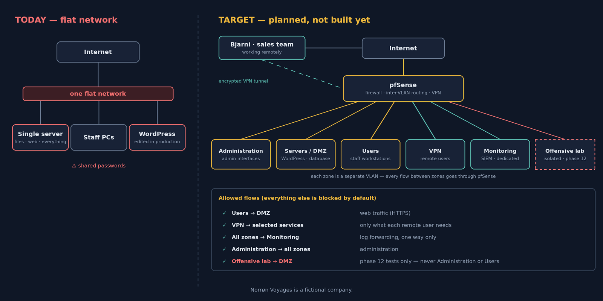

In the [previous article](../scenario/), Norrøn Voyages lost its website to an outdated plugin, on a flat network with shared passwords. Before touching anything, here is where I want to go — and in what order.

## The target

The target is a segmented network: each zone is a separate VLAN, and **every flow between zones goes through the pfSense firewall**. Everything is blocked by default; each flow is opened explicitly, for a reason.

- **Administration**: the admin interfaces of Proxmox and pfSense are only reachable from here;
- **Servers / DMZ**: the WordPress site and its database, the only part exposed to the Internet;
- **Users**: the staff's workstations, which reach the website like any visitor;
- **VPN**: Bjarni and the sales team connect through the Internet; their encrypted tunnel ends on pfSense, which only lets them reach the services they actually need;
- **Monitoring / SIEM**: in its own VLAN. Logs from every zone arrive one way only, so that an attacker who compromises a server can't reach the SIEM to erase their tracks;
- **Offensive lab**: an isolated attack machine for the final phase. It may reach the DMZ during the phase 12 tests, never the Administration or Users zones.

This is a **plan, not something already built**. It will change as I build it, and every change will be explained.

## The 13 phases

| # | Phase | Norrøn Voyages' need |
|---|---|---|
| 0 | The plan | Know where we're going before touching anything |
| 1 | Architecture | Audit the existing setup: the flat network |
| 2 | Proxmox, VMs, network | Rebuild on sound foundations |
| 3 | Hardening | Never again the spring incident |
| 4 | Remote access | Bjarni must work safely from Reykjavik |
| 5 | WordPress | Reinstall the website properly |
| 6 | Git / GitHub | No more direct changes in production |
| 7 | Jenkins | Update the site without downtime |
| 8 | Docker | The same environment from test to production |
| 9 | Kubernetes | Handle the January booking peak |
| 10 | Terraform / Ansible | Disaster recovery: rebuild everything fast |
| 11 | Monitoring | Know about problems before customers do |
| 12 | Blue Team | Prove to the NIS2 partner that attacks are detected |

The final phase closes the loop: I'll attack the infrastructure I built and secured myself, and show what my detection catches.

## How I'll document it

Each phase follows the same structure: **the company's need → what I set up → what went wrong or what I learned → the next step**. Mistakes included: they are part of learning, and often the most useful part.

Next step: phase 1, the audit of the flat network.
