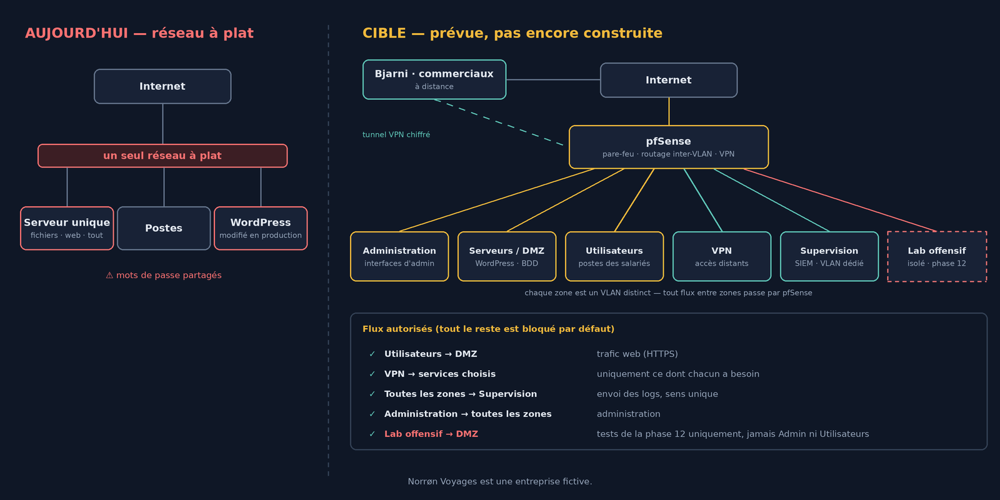

Dans l'[article précédent](../scenario/), Norrøn Voyages perdait son site à cause d'une extension pas à jour, sur un réseau à plat aux mots de passe partagés. Avant de toucher à quoi que ce soit, voici où je veux aller, et dans quel ordre.

## La cible

La cible est un réseau segmenté : chaque zone est un VLAN distinct, et **tout flux entre deux zones passe par le pare-feu pfSense**. Tout est bloqué par défaut ; chaque flux est ouvert explicitement, pour une raison précise.

- **Administration** : les interfaces d'administration de Proxmox et de pfSense ne sont accessibles que depuis cette zone ;
- **Serveurs / DMZ** : le site WordPress et sa base de données, seule partie exposée à Internet ;
- **Utilisateurs** : les postes des salariés, qui accèdent au site comme n'importe quel visiteur ;
- **VPN** : Bjarni et les commerciaux passent par Internet ; leur tunnel chiffré aboutit sur pfSense, qui ne les laisse atteindre que les services dont ils ont réellement besoin ;
- **Supervision / SIEM** : dans son propre VLAN. Les logs de toutes les zones y arrivent en sens unique, pour qu'un attaquant qui compromet un serveur ne puisse pas atteindre le SIEM pour effacer ses traces ;
- **Lab offensif** : une machine d'attaque isolée pour la dernière phase. Elle pourra atteindre la DMZ pendant les tests de la phase 12, jamais les zones Administration ou Utilisateurs.

C'est **un plan, pas quelque chose de déjà construit**. Il évoluera au fil de la construction, et chaque changement sera expliqué.

## Les 13 phases

| # | Phase | Le besoin de Norrøn Voyages |
|---|---|---|
| 0 | Le plan | Savoir où l'on va avant de toucher à quoi que ce soit |
| 1 | Architecture | Auditer l'existant : le réseau à plat |
| 2 | Proxmox, VM, réseau | Reconstruire sur des bases saines |
| 3 | Sécurisation | Plus jamais l'incident du printemps |
| 4 | Accès distant | Bjarni doit travailler depuis Reykjavik en sécurité |
| 5 | WordPress | Réinstaller le site proprement |
| 6 | Git / GitHub | Fini les modifications en direct sur la production |
| 7 | Jenkins | Mettre à jour le site sans coupure |
| 8 | Docker | Un environnement identique du test à la production |
| 9 | Kubernetes | Tenir le pic de réservations de janvier |
| 10 | Terraform / Ansible | Plan de reprise : tout reconstruire vite |
| 11 | Supervision | Savoir qu'il y a un problème avant les clients |
| 12 | Blue Team | Prouver au partenaire NIS2 qu'on détecte les attaques |

La dernière phase boucle la boucle : j'attaquerai l'infrastructure que j'ai moi-même construite et sécurisée, et je montrerai ce que ma détection repère.

## Comment je vais le documenter

Chaque phase suit la même structure : **le besoin de l'entreprise → ce que j'ai mis en place → ce qui a coincé ou ce que j'ai appris → la prochaine étape**. Erreurs comprises : elles font partie de l'apprentissage, et ce sont souvent les plus utiles.

Prochaine étape : la phase 1, l'audit du réseau à plat.
