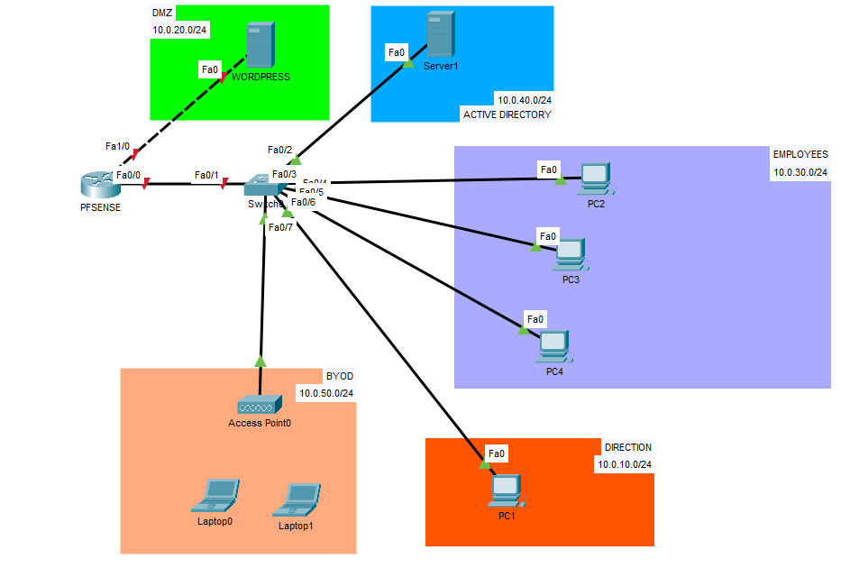
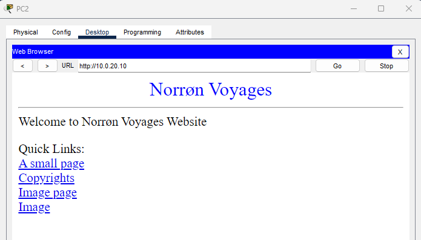
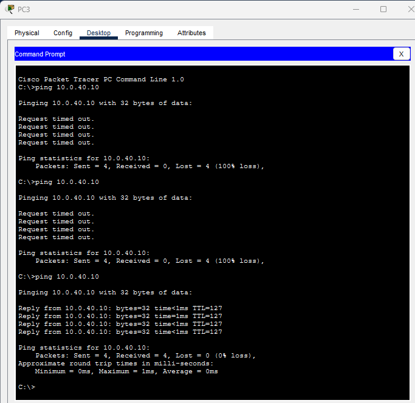
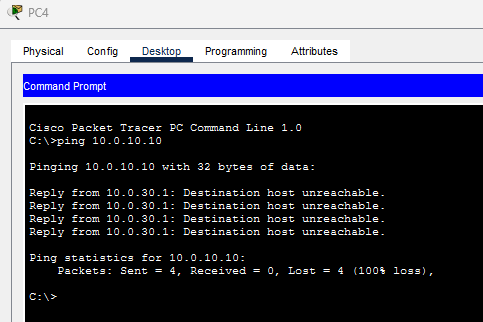
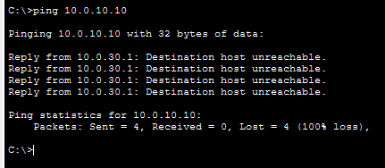
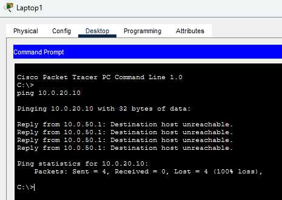
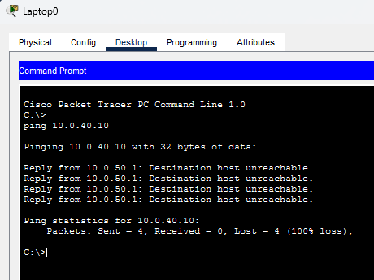
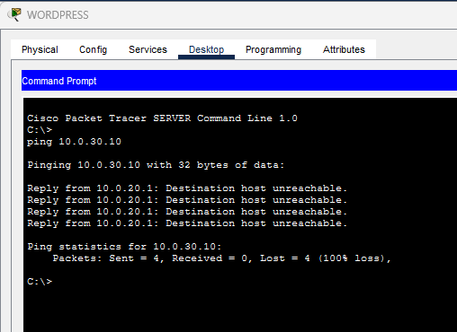

In the [previous article](../phase-00-plan/), I laid out the target architecture. Before building it for real on Proxmox, I test it in a simulator: if the plan has a flaw, I would rather find it here than halfway through the configuration.

> Norrøn Voyages is a fictional company, created to serve as the lab's scenario.

## The need

At Norrøn Voyages, everyone can see everything: a workstation, the web server, a personal phone on the Wi-Fi. That is what turned an outdated WordPress plugin into an incident that lasted several days.

So each zone must only be able to talk to what it genuinely needs, and everything else must be refused. And I want to check that with tests, not just on a diagram.

## What the mock-up simulates, and what it doesn't


In Packet Tracer, I only configure **the network**. A **router stands in for pfSense**. The VPN, Active Directory and the real WordPress will be built on the Proxmox homelab, not here. There is no WAN either: no Internet to simulate.


## The diagram



Five zones, each on its own subnet:

| Zone | What it holds | Why a separate zone |
|---|---|---|
| **Direction** | The manager's workstation | Kept apart from the employees' workstations |
| **Employees** | Three employee workstations | Access to the bare minimum: the directory and the website |
| **Active Directory** | The domain controller | One account per employee instead of shared passwords. Never in the DMZ |
| **BYOD** | A Wi-Fi access point and two laptops | Personal, unmanaged devices: no access to internal zones |
| **DMZ** | The web server | The only service meant to be exposed. If it is compromised, it must lead nowhere |

Compared with the phase 0 plan, the "Users" zone splits into Direction and Employees, and two zones are added: the directory and BYOD. The Administration zone, monitoring and the offensive lab are not in the mock-up; what to carry over to the real lab is still to be decided.

## The addressing plan

| Zone | VLAN | Network | Gateway |
|---|---|---|---|
| Direction | 10 | `10.0.10.0/24` | `10.0.10.1` |
| DMZ | — (dedicated port) | `10.0.20.0/24` | `10.0.20.1` |
| Employees | 30 | `10.0.30.0/24` | `10.0.30.1` |
| Active Directory | 40 | `10.0.40.0/24` | `10.0.40.1` |
| BYOD | 50 | `10.0.50.0/24` | `10.0.50.1` |

The router holds each zone's gateway. The DMZ has **its own physical port** on the router; the other four zones share a single trunk link to the switch, with one subinterface per VLAN. VLAN 99 is an unused native VLAN: untagged traffic on that link lands in no zone.

On the real lab, my mini PC has a single network card: the DMZ will be a VLAN like the others. That will need reworking in phase 2.

## 1 · The switch

VLANs first, one per zone:

```text
! --- Switch SW-SIEGE: create the VLANs ---
enable
configure terminal
hostname SW-SIEGE
vlan 10
 name DIRECTION
vlan 30
 name EMPLOYEES
vlan 40
 name ACTIVE-DIRECTORY
vlan 50
 name BYOD
vlan 99
 name NATIF-INUTILISE
exit
```

The link to the router, as a trunk limited to the VLANs in use:

```text
! --- Trunk to the router (Fa0/1) ---
interface fa0/1
 description Trunk vers FW-NORRON
 switchport mode trunk
 switchport trunk native vlan 99
 switchport trunk allowed vlan 10,30,40,50
```

One access port per device, in its zone's VLAN:

```text
! --- Access ports: one VLAN per zone ---
interface fa0/2
 description DC01
 switchport mode access
 switchport access vlan 40
interface range fa0/3 - 5
 description Employees
 switchport mode access
 switchport access vlan 30
interface fa0/6
 description Direction
 switchport mode access
 switchport access vlan 10
interface fa0/7
 description AP BYOD
 switchport mode access
 switchport access vlan 50
```

And we shut down whatever is unused before saving:

```text
! --- Unused ports shut down, then save ---
interface range fa0/8 - 24
 shutdown
end
write memory
```

## 2 · The router

The router is called `FW-NORRON`. The DMZ first, on its dedicated port:

```text
! --- Router FW-NORRON (pfSense's role): the DMZ on a dedicated port ---
enable
configure terminal
hostname FW-NORRON
interface fa1/0
 description DMZ
 ip address 10.0.20.1 255.255.255.0
 no shutdown
```

Then the trunk port towards the switch:

```text
! --- Trunk port towards the switch ---
interface fa0/0
 description Trunk vers SW-SIEGE
 no shutdown
```

Finally one subinterface per VLAN. Each one is its zone's gateway:

```text
! --- One subinterface per VLAN ---
interface fa0/0.10
 encapsulation dot1Q 10
 ip address 10.0.10.1 255.255.255.0
interface fa0/0.30
 encapsulation dot1Q 30
 ip address 10.0.30.1 255.255.255.0
interface fa0/0.40
 encapsulation dot1Q 40
 ip address 10.0.40.1 255.255.255.0
interface fa0/0.50
 encapsulation dot1Q 50
 ip address 10.0.50.1 255.255.255.0
end
write memory
```

## 3 · DHCP

The router hands out the workstations' addresses. The first addresses of each zone are reserved for fixed devices:

```text
! --- Addresses reserved for fixed devices ---
enable
configure terminal
ip dhcp excluded-address 10.0.10.1 10.0.10.20
ip dhcp excluded-address 10.0.30.1 10.0.30.20
ip dhcp excluded-address 10.0.50.1 10.0.50.20
```

Then one pool per client zone. Direction and Employees use the directory as their DNS; BYOD, being unmanaged devices, gets a public one:

```text
! --- One DHCP pool per client zone ---
ip dhcp pool DIRECTION
 network 10.0.10.0 255.255.255.0
 default-router 10.0.10.1
 dns-server 10.0.40.10
ip dhcp pool EMPLOYEES
 network 10.0.30.0 255.255.255.0
 default-router 10.0.30.1
 dns-server 10.0.40.10
ip dhcp pool BYOD
 network 10.0.50.0 255.255.255.0
 default-router 10.0.50.1
 dns-server 1.1.1.1
end
write memory
```

## 4 · The devices

The four PCs are simply switched to DHCP. The two servers get a fixed address:

| Device | Address | Mask | Gateway | DNS |
|---|---|---|---|---|
| WordPress server | `10.0.20.10` | `255.255.255.0` | `10.0.20.1` | none |
| Active Directory server | `10.0.40.10` | `255.255.255.0` | `10.0.40.1` | `10.0.40.10` (itself) |

The web server has **deliberately no internal DNS**: if it queried the directory, I would have to open a flow from the DMZ to the inside, exactly what I want to avoid.

On the Wi-Fi side, the access point broadcasts the `NORRON-BYOD` network with WPA2-PSK, and the two laptops, fitted with a Wi-Fi card, join it over DHCP.

## 5 · Filtering

The router filters with ACLs, applied **inbound** on each interface, as close to the source as possible. Anything not explicitly allowed is refused.

We start from a clean configuration:

```text
! --- Cleanup: start from scratch ---
enable
configure terminal
no ip access-list extended USERS-IN
no ip access-list extended BYOD-IN
no ip access-list extended DMZ-IN
```

**Direction and Employees** can reach the directory and the website, nothing else:

```text
! --- USERS-IN: Direction and Employees ---
ip access-list extended USERS-IN
 ! DHCP must get through, otherwise clients lose their address
 permit udp any eq 68 any eq 67
 ! to the directory (10.0.40.10): DNS, Kerberos, RPC, LDAP, SMB, ping
 permit udp any host 10.0.40.10 eq 53
 permit tcp any host 10.0.40.10 eq 53
 permit udp any host 10.0.40.10 eq 88
 permit tcp any host 10.0.40.10 eq 88
 permit tcp any host 10.0.40.10 eq 135
 permit udp any host 10.0.40.10 eq 389
 permit tcp any host 10.0.40.10 eq 389
 permit tcp any host 10.0.40.10 eq 445
 permit icmp any host 10.0.40.10 echo
 ! to the website (10.0.20.10): HTTP and HTTPS only
 permit tcp any host 10.0.20.10 eq 80
 permit tcp any host 10.0.20.10 eq 443
 ! ping replies
 permit icmp any any echo-reply
 ! everything else is refused
 deny ip any any
```

**BYOD** can go out, but no internal zone is reachable:

```text
! --- BYOD-IN: Internet yes, internal zones no ---
ip access-list extended BYOD-IN
 permit udp any eq 68 any eq 67
 deny ip any 10.0.0.0 0.0.255.255
 permit ip any any
```

The **DMZ** can only answer visitors, never start a connection towards the inside:

```text
! --- DMZ-IN: the site answers, it starts nothing ---
ip access-list extended DMZ-IN
 permit tcp host 10.0.20.10 eq 80 any established
 permit tcp host 10.0.20.10 eq 443 any established
 permit icmp any any echo-reply
 deny ip any any
```

Now each list gets attached to the right interface:

```text
! --- Apply the lists, inbound ---
interface fa0/0.10
 ip access-group USERS-IN in
interface fa0/0.30
 ip access-group USERS-IN in
interface fa0/0.50
 ip access-group BYOD-IN in
interface fa1/0
 ip access-group DMZ-IN in
end
write memory
```



```text
FW-NORRON#show access-lists
Extended IP access list USERS-IN
    10 permit udp any eq bootpc any eq bootps
    20 permit udp any host 10.0.40.10 eq domain
    30 permit tcp any host 10.0.40.10 eq domain
    40 permit udp any host 10.0.40.10 eq 88
    50 permit tcp any host 10.0.40.10 eq 88
    60 permit tcp any host 10.0.40.10 eq 135
    70 permit udp any host 10.0.40.10 eq 389
    80 permit tcp any host 10.0.40.10 eq 389
    90 permit tcp any host 10.0.40.10 eq 445
    100 permit icmp any host 10.0.40.10 echo
    110 permit tcp any host 10.0.20.10 eq www
    120 permit tcp any host 10.0.20.10 eq 443
    130 permit icmp any any echo-reply
    140 deny ip any any
Extended IP access list BYOD-IN
    10 permit udp any eq bootpc any eq bootps
    20 deny ip any 10.0.0.0 0.0.255.255
    30 permit ip any any
Extended IP access list DMZ-IN
    10 permit tcp host 10.0.20.10 eq www any established
    20 permit tcp host 10.0.20.10 eq 443 any established
    30 permit icmp any any echo-reply
    40 deny ip any any
```



## 6 · The tests

A diagram proves nothing: what matters is what gets through and what is blocked.

**What must get through.** From an Employees workstation, the website loads (it is Packet Tracer's default page, customised; the real WordPress comes in phase 5):



From PC3, a ping to the directory. It took three attempts, see below:



**What must be blocked.** Between two internal zones, an Employees workstation cannot reach the Direction workstation:




Personal devices reach neither the website nor the directory:




And the web server can start nothing towards the inside. If it is ever compromised, as in the scenario's incident, the attacker cannot pivot into the internal network:



In each blocked capture, the reply comes from the router's address (the zone's `.1`): it really is the router refusing.

## What got stuck, what I learned

- **The directory unreachable, twice.** First attempt: I had forgotten to configure the server. Second attempt: the gateway was entered wrongly, with the server's own address instead of the router's. Third attempt: it works. A wrong gateway doesn't raise an error, it just goes quiet.
- **"Request timed out" is not "Destination host unreachable".** The first means nobody answers (misconfigured server, bad cable). The second comes from the router itself: a rule is refusing. That difference helped me read my own tests.
- **A router's ACLs don't track connections.** They look at each packet on its own. That is why the DMZ rule uses `established` to let replies through, and why ping replies are allowed separately. A firewall like pfSense remembers connections and lets replies back in by itself.
- **The `log` keyword doesn't exist in Packet Tracer.** My first ACLs ended with `deny ip any any log` and the router rejected it. The implicit deny at the end of a list already does the job; I simply dropped `log`.

## The mock-up's limits

- The rules are simple and **don't track connections**, unlike what pfSense will do.
- The directory zone has **no filtering rules**: the domain controller can still start flows towards the other zones.
- **No WAN**: no NAT, and no Internet access test. The rule "BYOD can reach the Internet but not the internal network" is in place, but I can only check its second half.
- **The VPN and Active Directory** are not simulated here: they will be configured for real on Proxmox.

## Next step

Phase 2: rebuilding this network for real on Proxmox. pfSense replaces the router, the domain controller becomes a virtual machine, and the DMZ becomes a VLAN, since the mini PC has a single network card.
