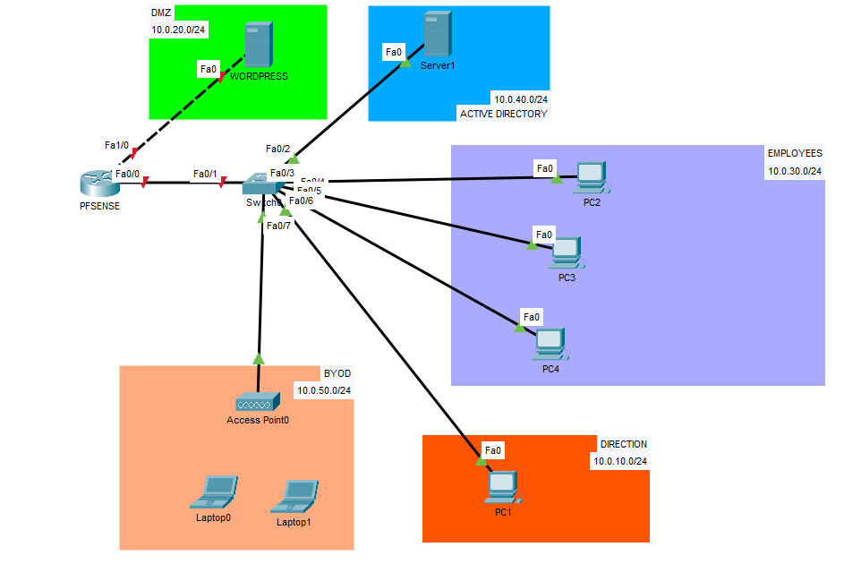
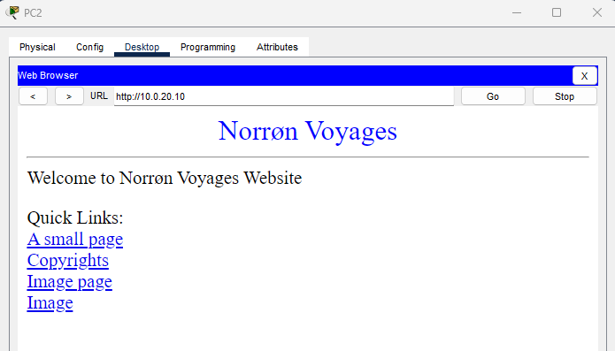
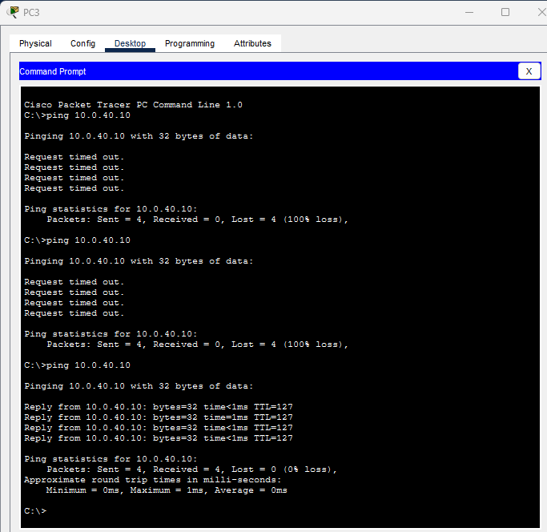
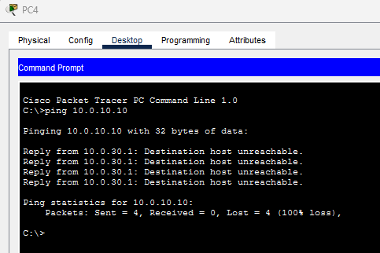
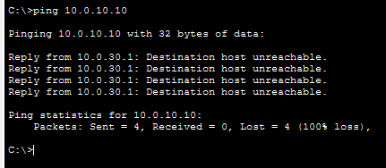
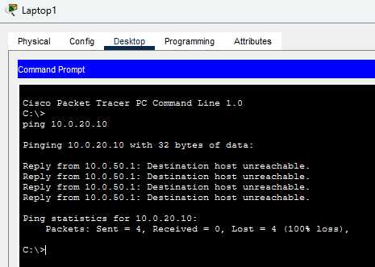
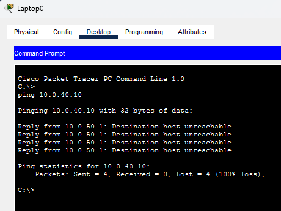
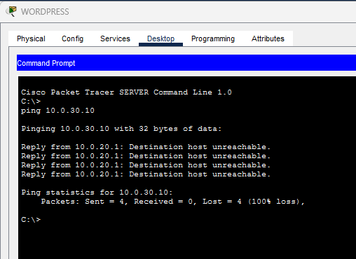

Dans l'[article précédent](../phase-00-plan/), je posais l'architecture cible. Avant de la construire pour de vrai sur le Proxmox, je la teste dans un simulateur : si le plan a un défaut, mieux vaut le trouver ici que plus tard, en pleine configuration.

> Norrøn Voyages est une entreprise fictive, créée pour servir de scénario au lab.

## Le besoin

Chez Norrøn Voyages, tout le monde voit tout : un poste, le serveur du site, un téléphone personnel connecté au Wi-Fi. C'est ce qui a transformé une extension WordPress pas à jour en incident de plusieurs jours.

Chaque zone doit donc ne pouvoir parler qu'à ce dont elle a réellement besoin, et tout le reste doit être refusé. Reste à le vérifier avec des tests, pas seulement sur un schéma.

## Ce que la maquette simule, et ce qu'elle ne simule pas


Dans Packet Tracer, je ne configure que **le réseau**. Un **routeur joue le rôle de pfSense**. Le VPN, l'Active Directory et le vrai WordPress seront montés sur le homelab Proxmox, pas ici. Il n'y a pas non plus de WAN : pas d'Internet à simuler.


## Le schéma



Cinq zones, chacune dans son propre sous-réseau :

| Zone | Ce qu'elle contient | Pourquoi une zone à part |
|---|---|---|
| **Direction** | Le poste de la dirigeante | Séparé des postes des salariés |
| **Employees** | Trois postes de salariés | Accès au strict nécessaire : l'annuaire et le site |
| **Active Directory** | Le contrôleur de domaine | Un compte par salarié au lieu des mots de passe partagés. Jamais dans la DMZ |
| **BYOD** | Un point d'accès Wi-Fi et deux ordinateurs portables | Appareils personnels, non gérés : aucun accès aux zones internes |
| **DMZ** | Le serveur du site | Seul service destiné à être exposé. S'il est compromis, il ne doit mener nulle part |

Par rapport au plan de la phase 0, la zone « Utilisateurs » se découpe en Direction et Employees, et deux zones s'ajoutent : l'annuaire et le BYOD. La zone Administration, la supervision et le lab offensif ne figurent pas dans la maquette ; il reste à décider ce qui en est repris sur le vrai lab.

## Le plan d'adressage

| Zone | VLAN | Réseau | Passerelle |
|---|---|---|---|
| Direction | 10 | `10.0.10.0/24` | `10.0.10.1` |
| DMZ | — (port dédié) | `10.0.20.0/24` | `10.0.20.1` |
| Employees | 30 | `10.0.30.0/24` | `10.0.30.1` |
| Active Directory | 40 | `10.0.40.0/24` | `10.0.40.1` |
| BYOD | 50 | `10.0.50.0/24` | `10.0.50.1` |

Le routeur porte la passerelle de chaque zone. La DMZ a **son propre port physique** sur le routeur ; les quatre autres zones partagent un seul lien « trunk » avec le switch, avec une sous-interface par VLAN. Le VLAN 99 est un VLAN natif inutilisé : le trafic non étiqueté sur ce lien n'atterrit dans aucune zone.

Sur le vrai lab, mon mini PC n'a qu'une seule carte réseau : la DMZ y sera un VLAN comme les autres. Ce sera à reprendre en phase 2.

## 1 · Le switch

Les VLAN d'abord, un par zone :

```text
! --- Switch SW-SIEGE : création des VLAN ---
enable
configure terminal
hostname SW-SIEGE
vlan 10
 name DIRECTION
vlan 30
 name EMPLOYEES
vlan 40
 name ACTIVE-DIRECTORY
vlan 50
 name BYOD
vlan 99
 name NATIF-INUTILISE
exit
```

Le lien vers le routeur, en trunk, limité aux VLAN utiles :

```text
! --- Trunk vers le routeur (Fa0/1) ---
interface fa0/1
 description Trunk vers FW-NORRON
 switchport mode trunk
 switchport trunk native vlan 99
 switchport trunk allowed vlan 10,30,40,50
```

Un port d'accès par équipement, dans le VLAN de sa zone :

```text
! --- Ports d'accès : un VLAN par zone ---
interface fa0/2
 description DC01
 switchport mode access
 switchport access vlan 40
interface range fa0/3 - 5
 description Employees
 switchport mode access
 switchport access vlan 30
interface fa0/6
 description Direction
 switchport mode access
 switchport access vlan 10
interface fa0/7
 description AP BYOD
 switchport mode access
 switchport access vlan 50
```

Et on éteint ce qui ne sert pas, avant de sauvegarder :

```text
! --- Ports inutilisés éteints, puis sauvegarde ---
interface range fa0/8 - 24
 shutdown
end
write memory
```

## 2 · Le routeur

Le routeur s'appelle `FW-NORRON`. D'abord la DMZ, sur son port dédié :

```text
! --- Routeur FW-NORRON (rôle de pfSense) : la DMZ sur un port dédié ---
enable
configure terminal
hostname FW-NORRON
interface fa1/0
 description DMZ
 ip address 10.0.20.1 255.255.255.0
 no shutdown
```

Puis le port du trunk vers le switch :

```text
! --- Port du trunk vers le switch ---
interface fa0/0
 description Trunk vers SW-SIEGE
 no shutdown
```

Enfin une sous-interface par VLAN. Chacune est la passerelle de sa zone :

```text
! --- Une sous-interface par VLAN ---
interface fa0/0.10
 encapsulation dot1Q 10
 ip address 10.0.10.1 255.255.255.0
interface fa0/0.30
 encapsulation dot1Q 30
 ip address 10.0.30.1 255.255.255.0
interface fa0/0.40
 encapsulation dot1Q 40
 ip address 10.0.40.1 255.255.255.0
interface fa0/0.50
 encapsulation dot1Q 50
 ip address 10.0.50.1 255.255.255.0
end
write memory
```

## 3 · Le DHCP

Le routeur distribue les adresses des postes. Les premières adresses de chaque zone sont réservées aux équipements fixes :

```text
! --- Adresses réservées aux équipements fixes ---
enable
configure terminal
ip dhcp excluded-address 10.0.10.1 10.0.10.20
ip dhcp excluded-address 10.0.30.1 10.0.30.20
ip dhcp excluded-address 10.0.50.1 10.0.50.20
```

Puis un pool par zone cliente. Direction et Employees utilisent l'annuaire comme DNS ; le BYOD, des appareils non gérés, un DNS public :

```text
! --- Un pool DHCP par zone cliente ---
ip dhcp pool DIRECTION
 network 10.0.10.0 255.255.255.0
 default-router 10.0.10.1
 dns-server 10.0.40.10
ip dhcp pool EMPLOYEES
 network 10.0.30.0 255.255.255.0
 default-router 10.0.30.1
 dns-server 10.0.40.10
ip dhcp pool BYOD
 network 10.0.50.0 255.255.255.0
 default-router 10.0.50.1
 dns-server 1.1.1.1
end
write memory
```

## 4 · Les équipements

Les quatre PC sont simplement passés en DHCP. Les deux serveurs ont une adresse fixe :

| Équipement | Adresse | Masque | Passerelle | DNS |
|---|---|---|---|---|
| Serveur WordPress | `10.0.20.10` | `255.255.255.0` | `10.0.20.1` | aucun |
| Serveur Active Directory | `10.0.40.10` | `255.255.255.0` | `10.0.40.1` | `10.0.40.10` (lui-même) |

Le serveur du site n'a **volontairement aucun DNS interne** : s'il interrogeait l'annuaire, il faudrait ouvrir un flux de la DMZ vers l'intérieur, exactement ce qu'on veut éviter.

Côté Wi-Fi, le point d'accès diffuse le réseau `NORRON-BYOD` en WPA2-PSK, et les deux ordinateurs portables, équipés d'une carte Wi-Fi, s'y connectent en DHCP.

## 5 · Le filtrage

Le routeur filtre avec des ACL, appliquées **en entrée** sur chaque interface, au plus près de la source. Tout ce qui n'est pas explicitement autorisé est refusé.

On repart d'une configuration propre :

```text
! --- Nettoyage : on repart de zéro ---
enable
configure terminal
no ip access-list extended USERS-IN
no ip access-list extended BYOD-IN
no ip access-list extended DMZ-IN
```

**Direction et Employees** peuvent joindre l'annuaire et le site, rien d'autre :

```text
! --- USERS-IN : Direction et Employees ---
ip access-list extended USERS-IN
 ! le DHCP doit passer, sinon les clients n'ont plus d'adresse
 permit udp any eq 68 any eq 67
 ! vers l'annuaire (10.0.40.10) : DNS, Kerberos, RPC, LDAP, SMB, ping
 permit udp any host 10.0.40.10 eq 53
 permit tcp any host 10.0.40.10 eq 53
 permit udp any host 10.0.40.10 eq 88
 permit tcp any host 10.0.40.10 eq 88
 permit tcp any host 10.0.40.10 eq 135
 permit udp any host 10.0.40.10 eq 389
 permit tcp any host 10.0.40.10 eq 389
 permit tcp any host 10.0.40.10 eq 445
 permit icmp any host 10.0.40.10 echo
 ! vers le site (10.0.20.10) : HTTP et HTTPS uniquement
 permit tcp any host 10.0.20.10 eq 80
 permit tcp any host 10.0.20.10 eq 443
 ! les réponses aux ping
 permit icmp any any echo-reply
 ! tout le reste est refusé
 deny ip any any
```

Le **BYOD** peut aller vers l'extérieur, mais aucune zone interne n'est joignable :

```text
! --- BYOD-IN : Internet oui, zones internes non ---
ip access-list extended BYOD-IN
 permit udp any eq 68 any eq 67
 deny ip any 10.0.0.0 0.0.255.255
 permit ip any any
```

La **DMZ** ne peut que répondre aux visiteurs, jamais initier de connexion vers l'intérieur :

```text
! --- DMZ-IN : le site répond, il n'initie rien ---
ip access-list extended DMZ-IN
 permit tcp host 10.0.20.10 eq 80 any established
 permit tcp host 10.0.20.10 eq 443 any established
 permit icmp any any echo-reply
 deny ip any any
```

Reste à brancher chaque liste sur la bonne interface :

```text
! --- Application des listes, en entrée ---
interface fa0/0.10
 ip access-group USERS-IN in
interface fa0/0.30
 ip access-group USERS-IN in
interface fa0/0.50
 ip access-group BYOD-IN in
interface fa1/0
 ip access-group DMZ-IN in
end
write memory
```



```text
FW-NORRON#show access-lists
Extended IP access list USERS-IN
    10 permit udp any eq bootpc any eq bootps
    20 permit udp any host 10.0.40.10 eq domain
    30 permit tcp any host 10.0.40.10 eq domain
    40 permit udp any host 10.0.40.10 eq 88
    50 permit tcp any host 10.0.40.10 eq 88
    60 permit tcp any host 10.0.40.10 eq 135
    70 permit udp any host 10.0.40.10 eq 389
    80 permit tcp any host 10.0.40.10 eq 389
    90 permit tcp any host 10.0.40.10 eq 445
    100 permit icmp any host 10.0.40.10 echo
    110 permit tcp any host 10.0.20.10 eq www
    120 permit tcp any host 10.0.20.10 eq 443
    130 permit icmp any any echo-reply
    140 deny ip any any
Extended IP access list BYOD-IN
    10 permit udp any eq bootpc any eq bootps
    20 deny ip any 10.0.0.0 0.0.255.255
    30 permit ip any any
Extended IP access list DMZ-IN
    10 permit tcp host 10.0.20.10 eq www any established
    20 permit tcp host 10.0.20.10 eq 443 any established
    30 permit icmp any any echo-reply
    40 deny ip any any
```



## 6 · Les tests

Un schéma ne prouve rien : ce qui compte, c'est ce qui passe et ce qui est bloqué.

**Ce qui doit passer.** Depuis un poste Employees, le site s'affiche (c'est la page par défaut de Packet Tracer, personnalisée ; le vrai WordPress viendra en phase 5) :



Depuis PC3, le ping vers l'annuaire. Il a fallu trois essais, voir plus bas :



**Ce qui doit être bloqué.** Entre deux zones internes, un poste Employees ne peut pas joindre le poste de la Direction :




Les appareils personnels n'atteignent ni le site, ni l'annuaire :




Et le serveur du site ne peut rien initier vers l'intérieur. Si un jour il est compromis, comme dans l'incident du scénario, l'attaquant ne peut pas rebondir vers le réseau interne :



Dans chaque capture de blocage, la réponse vient de l'adresse du routeur (`.1` de la zone) : c'est bien lui qui refuse.

## Ce qui a coincé, ce que j'ai appris

- **L'annuaire injoignable, deux fois.** Premier essai : j'avais oublié de configurer le serveur. Deuxième essai : la passerelle était mal saisie, avec l'adresse du serveur lui-même au lieu de celle du routeur. Troisième essai : ça passe. Une passerelle fausse ne fait pas d'erreur, elle fait simplement un silence.
- **« Request timed out » n'est pas « Destination host unreachable ».** Le premier veut dire que personne ne répond (serveur mal configuré, mauvais câble). Le second vient du routeur lui-même : c'est une règle qui refuse. Cette différence m'a servi à lire mes propres tests.
- **Les ACL d'un routeur ne suivent pas les connexions.** Elles regardent chaque paquet isolément. C'est pour ça que la règle de la DMZ utilise `established` pour laisser passer les réponses, et que les réponses aux ping sont autorisées à part. Un pare-feu comme pfSense, lui, mémorise les connexions et laisse revenir les réponses tout seul.
- **Le mot-clé `log` n'existe pas dans Packet Tracer.** Mes premières ACL se terminaient par `deny ip any any log` et le routeur l'a refusé. Le refus implicite de fin de liste fait déjà le travail ; j'ai simplement retiré `log`.

## Les limites de la maquette

- Les règles sont simples et **sans suivi de connexion**, contrairement à ce que fera pfSense.
- La zone de l'annuaire n'a **pas de règles de filtrage** : le contrôleur de domaine peut encore initier des flux vers les autres zones.
- **Pas de WAN** : ni NAT, ni test d'accès à Internet. La règle « le BYOD va sur Internet mais pas sur le réseau interne » est posée, mais je ne peux vérifier que sa deuxième moitié.
- **Le VPN et l'Active Directory** ne sont pas simulés ici : ils seront configurés pour de vrai sur le Proxmox.

## La prochaine étape

La phase 2 : reconstruire ce réseau pour de vrai sur le Proxmox. pfSense remplace le routeur, le contrôleur de domaine devient une machine virtuelle, et la DMZ devient un VLAN, puisque le mini PC n'a qu'une seule carte réseau.
