In the [previous article](../phase-02-reseau-pfsense/), I built the network: pfSense, an admin LAN and five zones. What is still missing is what gives those zones a purpose: a directory, some PCs, and proof that the separation holds.

> Norrøn Voyages is a fictional company, created to serve as the lab's scenario.

## The need

At Norrøn Voyages, passwords are shared between colleagues. It needs one account per person, rights by team, and an administration that does not go through everyone's daily account.

## The directory

I install Windows Server 2022, then the Active Directory role. I rename the server (`mimir`), give it a static address, and create the `norron.internal` domain.

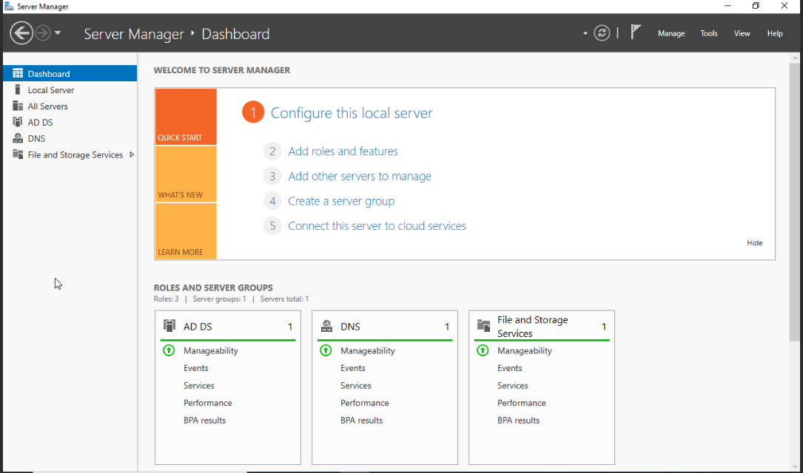

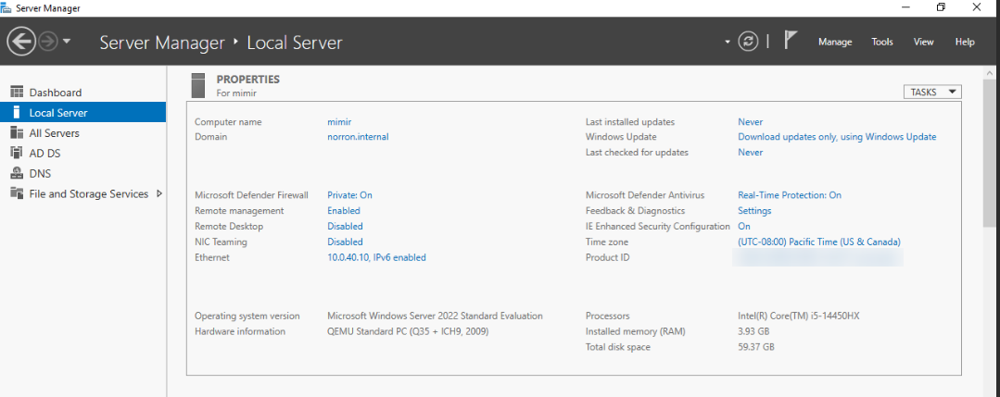

While I'm at it, I create a few accounts, including an administrator account named `adm.cedric`, separate from my daily account, and one for our presumed director: Hélène Marchand. Accounts are organized in organizational units, one per team.

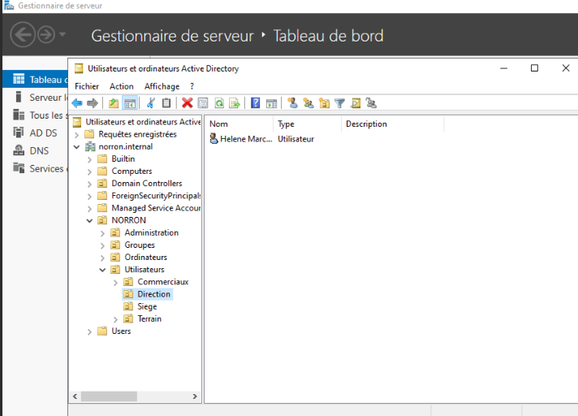

Once the PCs have joined the domain, I close a door: by default, any user can add up to ten machines to the domain. I set that quota to zero:

```powershell
Set-ADDomain -Identity norron.internal -Replace @{"ms-DS-MachineAccountQuota"="0"}
```

## The client PCs

I put a first PC in VLAN 30. I use Windows 10 rather than Windows 11, simply because it uses a bit less memory. I make sure to rename the PC before joining it to the domain. Everything works.

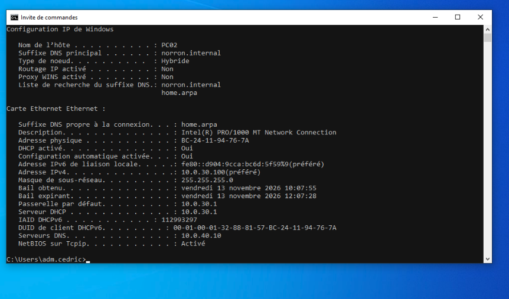

Then I install a PC in VLAN 10 and check that it works the same way.

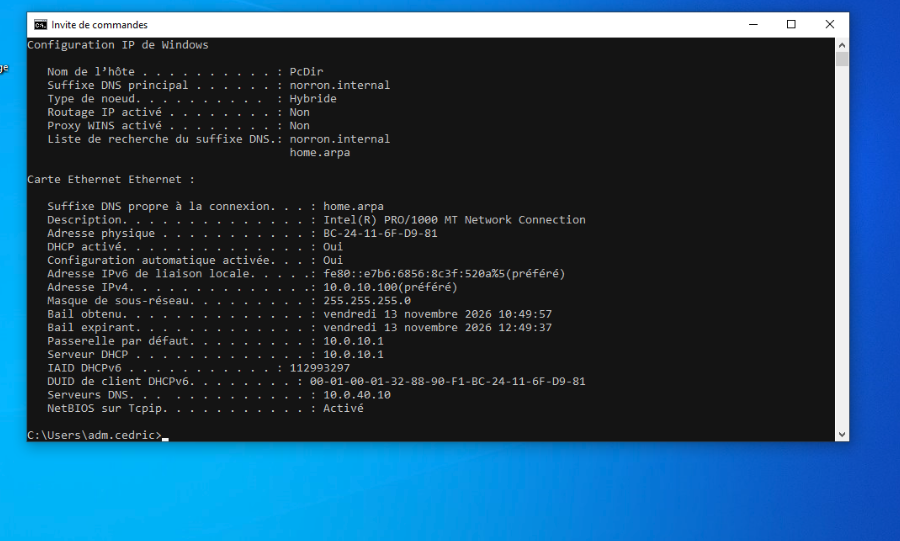

## The isolation test

A Management PC must not reach a Staff PC, and the other way round. I test a ping in both directions:

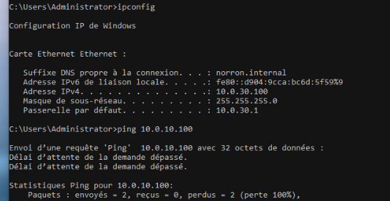

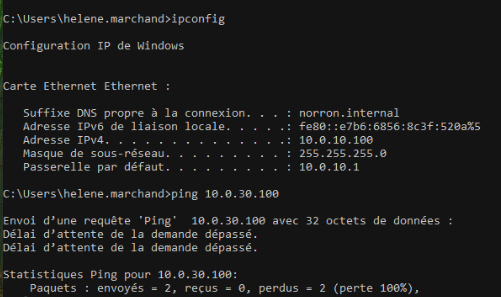

Both times, no reply. But a ping with no reply does not, on its own, prove that pfSense refused it: Windows also blocks incoming pings by default. The proof is in the firewall log (`Status > System Logs > Firewall`):

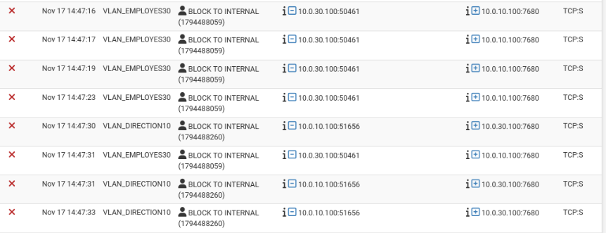

Each red line is a connection refused by the `BLOCK TO INTERNAL` rule of the Staff or Management zone, between `10.0.30.100` and `10.0.10.100`. A fun detail: these are not my pings, but connection attempts on port 7680, which Windows uses to share updates between nearby PCs. Without me doing anything, the two PCs try to talk to each other, and pfSense blocks them.

## The backups

Just because it's a practice lab doesn't mean I shouldn't back up my machines. I'll use `vzdump` and copy the backups to my personal PC, for lack of other disks.

I start with a **snapshot** of each machine. It is a quick way back after a bad change:

```bash
for id in 100 101 200 202 203; do
  qm snapshot $id phase2-ok --description "Phase 2 done: network, AD, 2 joined PCs"
done
```

A snapshot stays on the same disk as the machine, though: if the disk fails, everything is lost together. So I also run a real **backup**, without stopping the machines, compressed:

```bash
vzdump 100 101 200 202 203 --mode snapshot --compress zstd --storage local
```

I check that the files are there:

```bash
ls /var/lib/vz/dump/
```

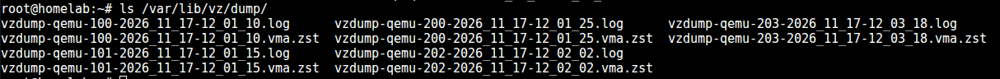

On my PC, I create a folder reserved for my user (these files contain the directory and the pfSense configuration), then copy each backup there with `rsync`:

```bash
mkdir -p ~/Sauvegardes/homelab
chmod 700 ~/Sauvegardes/homelab
rsync -avP root@192.168.1.103:/var/lib/vz/dump/vzdump-qemu-100-* ~/Sauvegardes/homelab/
```

Same command for the other machines (101, 200, 202 and 203). Everything is there:

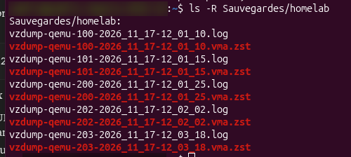

What is left is checking that the copies are identical to the originals. I compute each file's checksum on both sides: the two strings must match.

```bash
ssh root@192.168.1.103 "sha256sum /var/lib/vz/dump/vzdump-qemu-100-*.vma.zst"
sha256sum ~/Sauvegardes/homelab/vzdump-qemu-100-*.vma.zst
```

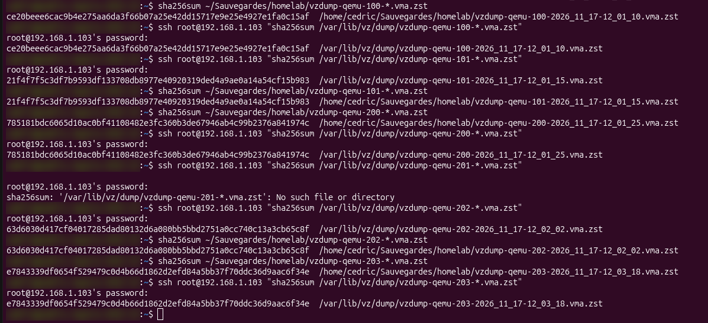

## What I learned

- **A snapshot is not a backup.** The first undoes a mistake, the second survives the loss of the disk.
- **A copy needs checking.** Comparing checksums takes a minute and avoids discovering a corrupted file the day it is needed.
- **Close doors by default.** The domain join quota is one example: a convenient default is not necessarily a safe one.

## Limits

- **I have not tested a restore yet.** A backup that has never been restored is only a hypothesis. That will come later.
- **One copy, on one PC.** That is not enough for a real company.
- **`root` SSH access is still open**, which I used to copy the files. I will restrict it in the next phase.

## Next step

Phase 3: hardening. Reduce ports and access to the bare minimum, move to SSH keys, and harden Proxmox, pfSense and Linux.
