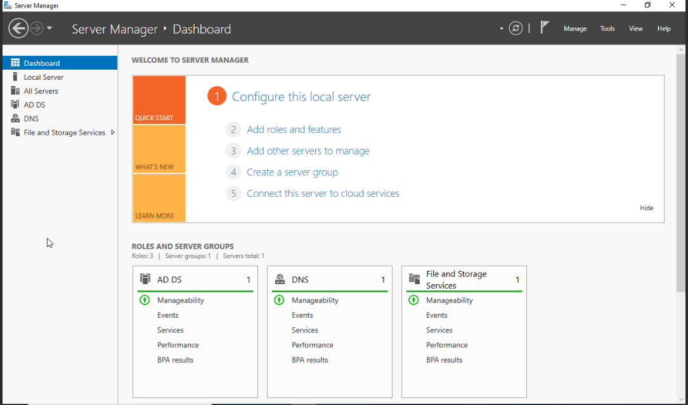
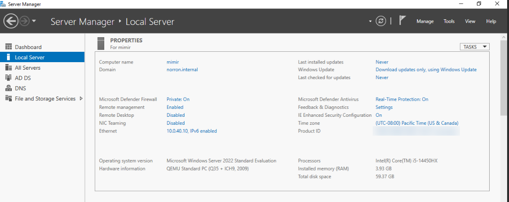
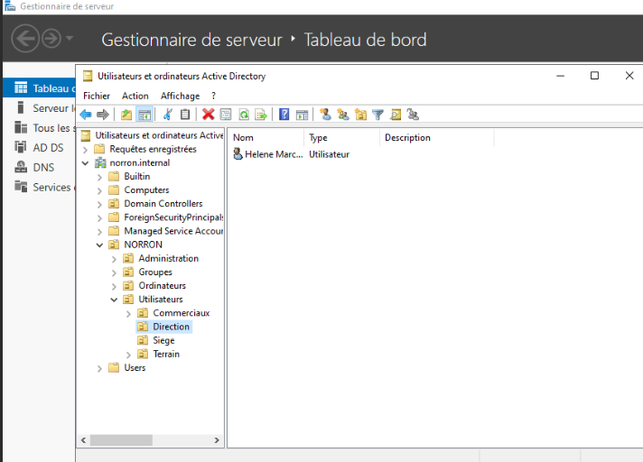
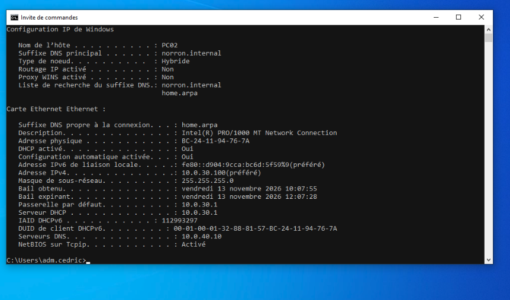
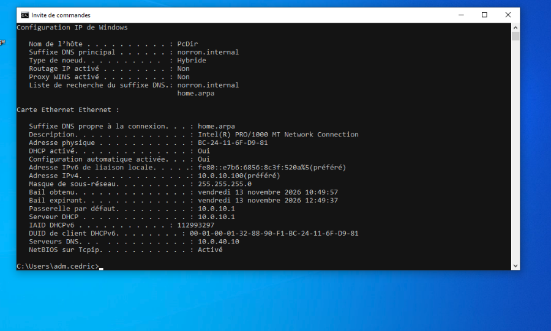
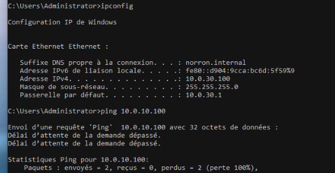
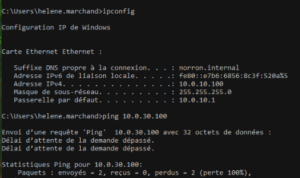
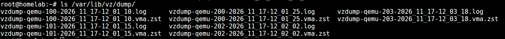
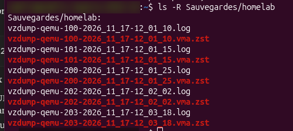
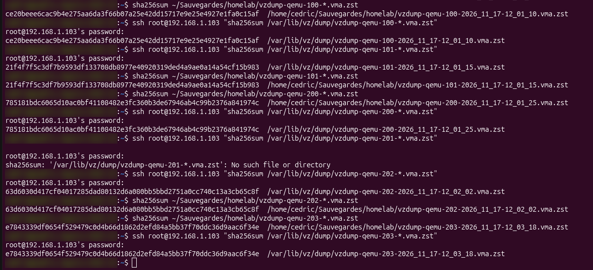

Dans l'[article précédent](../phase-02-reseau-pfsense/), j'ai construit le réseau : pfSense, un LAN d'administration et cinq zones. Il manque encore ce qui donne un sens à ces zones : un annuaire, des postes, et la preuve que le cloisonnement tient.

> Norrøn Voyages est une entreprise fictive, créée pour servir de scénario au lab.

## Le besoin

Chez Norrøn Voyages, les mots de passe se partagent entre collègues. Il faut un compte par personne, des droits par service, et une administration qui ne passe pas par le compte de tous les jours.

## L'annuaire

J'installe Windows Server 2022, puis le rôle Active Directory. Je renomme le serveur (`mimir`), je lui donne une adresse fixe, et je crée le domaine `norron.internal`.





J'en profite pour créer quelques comptes, notamment un compte administrateur nommé `adm.cedric`, distinct de mon compte du quotidien, puis un compte pour notre directrice présumée : Hélène Marchand. Les comptes sont rangés dans des unités d'organisation, une par service.



Une fois les postes joints au domaine, je ferme une porte : par défaut, n'importe quel utilisateur peut ajouter jusqu'à dix machines au domaine. Je passe ce quota à zéro :

```powershell
Set-ADDomain -Identity norron.internal -Replace @{"ms-DS-MachineAccountQuota"="0"}
```

## Les postes clients

Je place un premier poste dans le VLAN 30. J'utilise Windows 10 plutôt que Windows 11, simplement parce qu'il consomme un peu moins de mémoire. Je pense à bien renommer le PC avant de le joindre au domaine. Tout fonctionne.



J'installe ensuite un poste dans le VLAN 10 et je vérifie que tout fonctionne de la même façon.



## Le test d'isolation

Un poste de la Direction ne doit pas joindre un poste des Employés, et inversement. Je teste un ping dans les deux sens :





Dans les deux cas, aucune réponse : c'est ce que prévoient les règles de pfSense.


**Limite du test.** Windows bloque aussi les pings entrants par défaut. Un ping sans réponse ne prouve donc pas, à lui seul, que c'est pfSense qui a refusé. La preuve la plus solide est la ligne de blocage dans le journal du pare-feu (`Status > System Logs > Firewall`).


## Les sauvegardes

Ce n'est pas parce que c'est un lab d'exercice qu'on ne sauvegarde pas ses machines. Je vais utiliser `vzdump` et copier les sauvegardes sur mon PC personnel, à défaut d'autres disques.

Je commence par un **snapshot** de chaque machine. C'est un point de retour rapide en cas de mauvaise manipulation :

```bash
for id in 100 101 200 202 203; do
  qm snapshot $id phase2-ok --description "Phase 2 terminee : reseau, AD, 2 postes joints"
done
```

Un snapshot reste cependant sur le même disque que la machine : si le disque lâche, tout disparaît ensemble. Je lance donc aussi une vraie **sauvegarde**, sans arrêter les machines, compressée :

```bash
vzdump 100 101 200 202 203 --mode snapshot --compress zstd --storage local
```

Je vérifie que les fichiers sont bien là :

```bash
ls /var/lib/vz/dump/
```



Sur mon PC, je crée un dossier réservé à mon utilisateur (ces fichiers contiennent l'annuaire et la configuration de pfSense), puis j'y copie chaque sauvegarde avec `rsync` :

```bash
mkdir -p ~/Sauvegardes/homelab
chmod 700 ~/Sauvegardes/homelab
rsync -avP root@192.168.1.103:/var/lib/vz/dump/vzdump-qemu-100-* ~/Sauvegardes/homelab/
```

Même commande pour les autres machines (101, 200, 202 et 203). Tout est là :



Reste à vérifier que les copies sont identiques aux originaux. Je calcule l'empreinte de chaque fichier des deux côtés : les deux séries de caractères doivent être les mêmes.

```bash
ssh root@192.168.1.103 "sha256sum /var/lib/vz/dump/vzdump-qemu-100-*.vma.zst"
sha256sum ~/Sauvegardes/homelab/vzdump-qemu-100-*.vma.zst
```



## Ce que j'ai appris

- **Un snapshot n'est pas une sauvegarde.** Le premier annule une erreur, la seconde survit à la perte du disque.
- **Une copie se vérifie.** Comparer les empreintes prend une minute et évite de découvrir un fichier corrompu le jour où on en a besoin.
- **Fermer les portes par défaut.** Le quota de jonction au domaine en est un exemple : une valeur par défaut pratique n'est pas forcément sûre.

## Les limites

- **Je n'ai pas encore testé de restauration.** Une sauvegarde qui n'a jamais été restaurée reste une hypothèse. Ce sera fait plus tard.
- **Une seule copie, sur un seul PC.** Ce n'est pas suffisant pour une vraie entreprise.
- **L'accès `root` en SSH est encore ouvert**, ce qui m'a servi pour copier les fichiers. Je le restreindrai dans la phase suivante.

## La prochaine étape

La phase 3 : la sécurisation. Réduire les ports et les accès au strict minimum, passer aux clés SSH, et durcir Proxmox, pfSense et Linux.
