In the [previous article](../phase-01-architecture/), I tested the target network in Packet Tracer. This time, I build it for real on my Proxmox server.

> Norrøn Voyages is a fictional company, created to serve as the lab's scenario.

## The need

Norrøn Voyages runs on a flat network: everyone can see everything. It needs zones that only talk when they have to, and a firewall to enforce that.

## The hardware

A NiPoGi mini PC: 32 GB of RAM, 1 TB of storage, an i5-14450HX processor (10 cores, 16 threads). Proxmox is already installed.

## First settings on Proxmox

I start by not working as `root`. I create an admin account to log into the Proxmox web interface, with the `PVEAdmin` role.

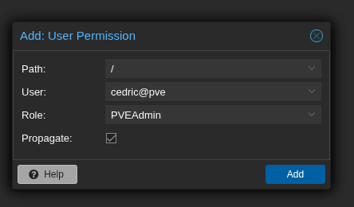

I also create a Linux user with `sudo` rights, to manage the server from the command line:

```bash
apt install sudo
adduser cedric
usermod -aG sudo cedric
```

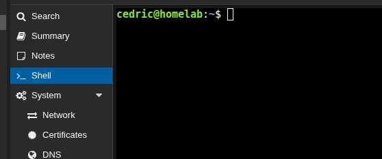

Next, I disable the enterprise repositories and run a full upgrade. Proxmox recommends `full-upgrade` over `upgrade`:

```bash
sudo apt update && sudo apt full-upgrade
```

The system is clean. I will come back to hardening in a few phases.

## The architecture

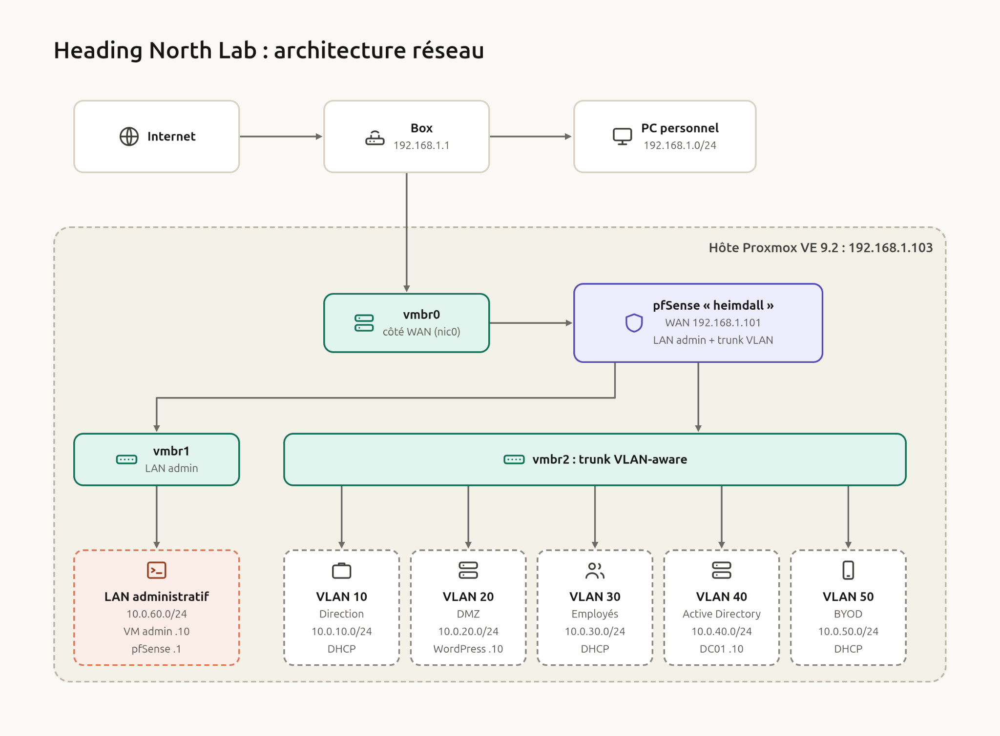

One change from the plan: I add an **admin machine**. It wasn't planned, but I'm allowed to change my mind.

The idea: administration goes through a network separate from production. If I get a VLAN wrong, I still have access to pfSense, and the anti-lockout rule protects me. I can break my VLANs without locking myself out.

| Network | Role |
|---|---|
| `vmbr0` | Internet side (WAN) |
| `vmbr1` | Admin LAN: pfSense and the admin machine (Debian) |
| `vmbr2` | VLAN-aware trunk, carrying VLANs 10, 20, 30, 40 and 50 |

## pfSense

All my ISO images are already in Proxmox. I install pfSense with a minimal configuration: 2 cores, 20 GB of storage, 2 GB of memory. The VM is called `heimdall`.

A few IP conflicts later, it is up. By default, the installer gives pfSense my home router's address, and Netgate becomes unreachable. I fixed it by restarting the installation **without assigning a LAN interface** at first, then configuring the network myself.

The machine has three network cards: the WAN, the admin LAN and a third port that serves as the trunk.

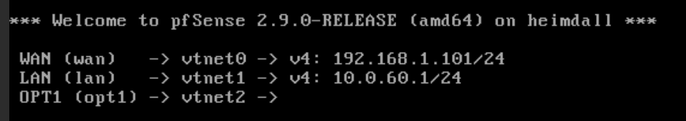

### The VLANs

I create my first VLAN on the trunk port, then the other four.

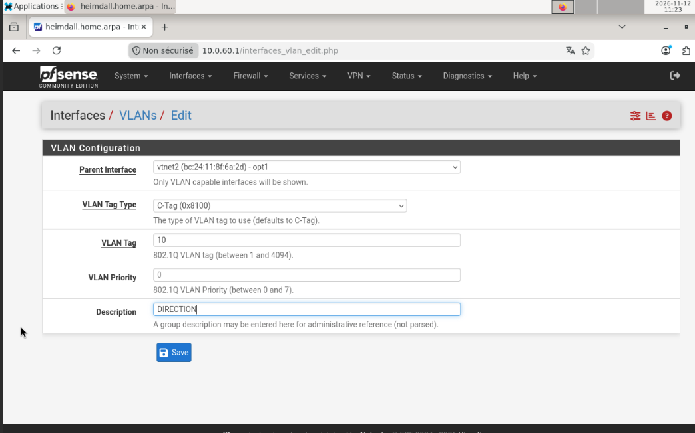

| VLAN | Zone | Network | Addresses |
|---|---|---|---|
| 10 | Management | `10.0.10.0/24` | DHCP |
| 20 | DMZ | `10.0.20.0/24` | static |
| 30 | Staff | `10.0.30.0/24` | DHCP |
| 40 | Active Directory | `10.0.40.0/24` | static |
| 50 | BYOD | `10.0.50.0/24` | DHCP |

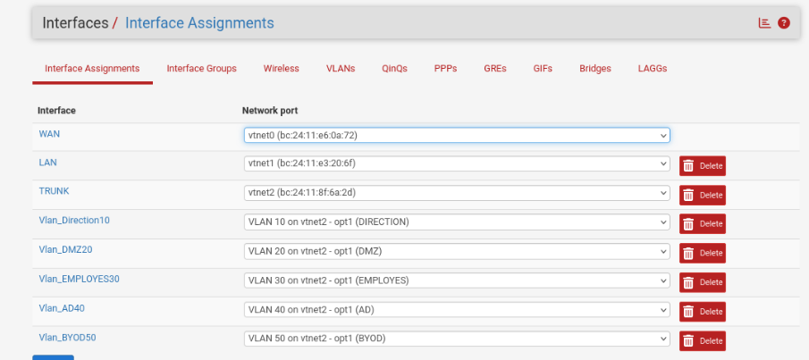

### DHCP

I set up DHCP for VLAN 10. Worth noting: I use Kea, as pfSense recommends. VLANs 20 and 40 have no DHCP, since their machines will use static addresses.

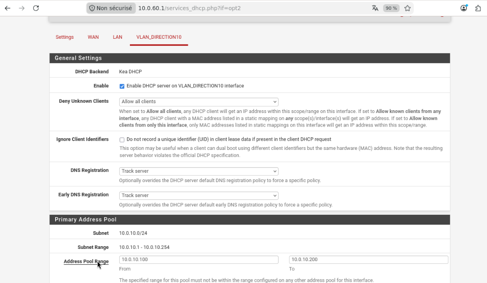

## The firewall

pfSense blocks everything by default on a new interface, so I have to open what is needed. Rules apply to traffic **entering** the interface, and the first matching rule wins. Their order matters as much as their content.

I start with aliases, to keep things readable:

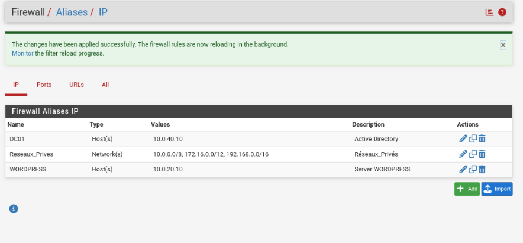

### BYOD

Personal devices can ask pfSense for DNS and reach the Internet, but they cannot reach any internal zone.

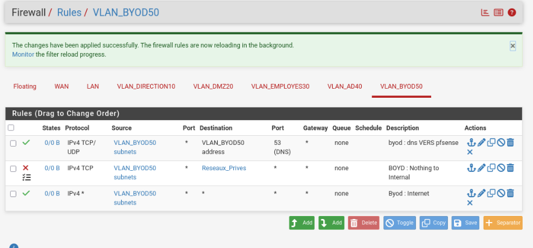

### DMZ

For the DMZ, the idea is to let out only what is strictly needed, and never to initiate anything towards the inside. Since I will repeat the same ports in several rules, I group them in an alias:

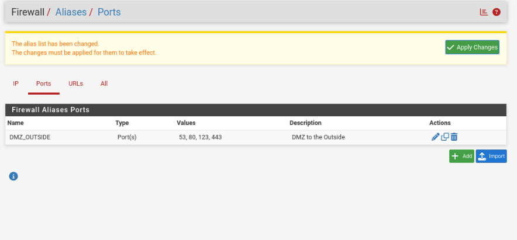

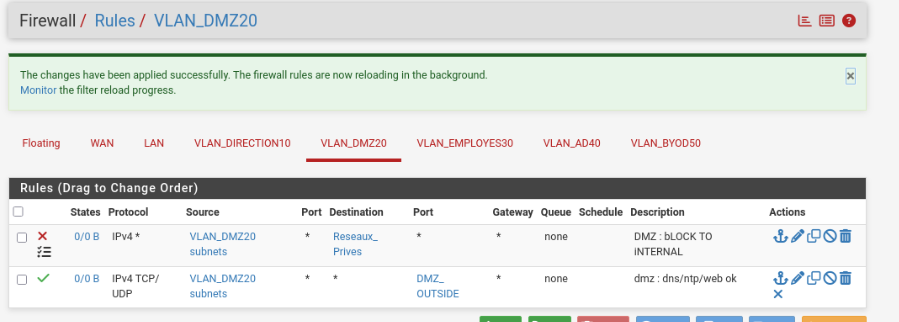

### Management and Staff

Same rules for both zones: the directory and the WordPress server are reachable, the rest of the internal network is blocked, the Internet is allowed.

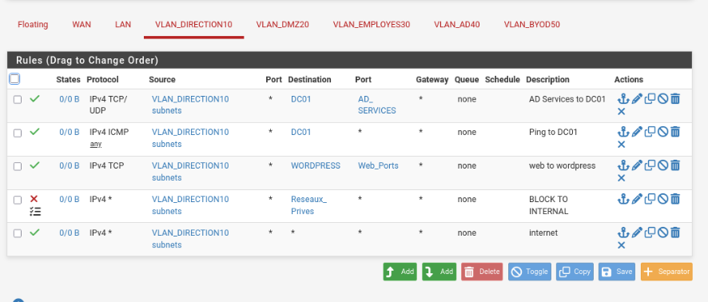

### Active Directory

The directory zone can go out for the bare minimum (DNS, time, web for updates), but not towards the other zones.

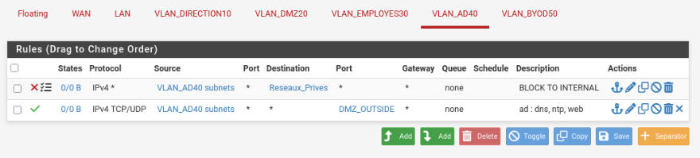

There, the worst is over. I'm not a fan of configuring pfSense, I confess, but it has to be done seriously and carefully.

## What got in the way

- **An address conflict right from the install.** pfSense took my home router's address, and I could no longer reach Netgate. I fixed it by restarting the installation without configuring the LAN.
- **Rule order.** An "allow all" rule placed above a block rule makes the block useless. Blocks must always come before broad allows.

## Next step

The network is in place. In the [next article](../phase-02-annuaire-postes-sauvegardes/), I install the Active Directory, place two PCs in two zones, test the isolation between them, and back everything up.
