Dans l'[article précédent](../phase-01-architecture/), je testais le réseau cible dans Packet Tracer. Cette fois, je le construis pour de vrai sur mon Proxmox.

> Norrøn Voyages est une entreprise fictive, créée pour servir de scénario au lab.

## Le besoin

Norrøn Voyages vit sur un réseau à plat : tout le monde voit tout. Il faut des zones qui ne se parlent que lorsque c'est nécessaire, et un pare-feu qui fait respecter tout ça.

## Le matériel

Un mini PC NiPoGi : 32 Go de RAM, 1 To de disque, processeur i5-14450HX (10 cœurs, 16 threads). Proxmox y est déjà installé.

## Premiers réglages sur Proxmox

Je commence par ne pas travailler avec `root`. Je crée un compte d'administration pour me connecter à l'interface web de Proxmox, avec le rôle `PVEAdmin`.

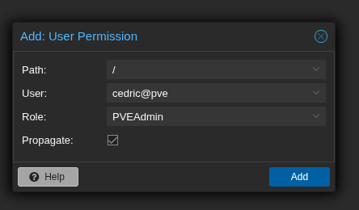

Je crée aussi un utilisateur Linux avec les droits `sudo`, pour gérer le serveur en ligne de commande :

```bash
apt install sudo
adduser cedric
usermod -aG sudo cedric
```

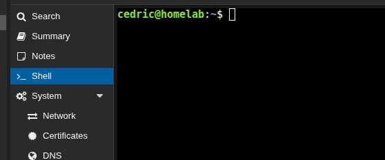

Ensuite, je désactive les dépôts « enterprise » et je fais une mise à jour complète. Proxmox recommande `full-upgrade` plutôt que `upgrade` :

```bash
sudo apt update && sudo apt full-upgrade
```

Le système est propre. Je reviendrai sur le durcissement dans quelques phases.

## L'architecture

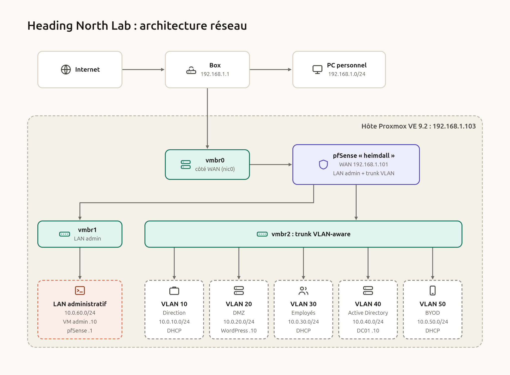

Une nouveauté par rapport au plan : j'ajoute une **machine d'administration**. Ce n'était pas prévu, mais on a le droit de changer d'avis.

Le principe : l'administration passe par un réseau séparé de la production. Si je me trompe sur un VLAN, je garde la main sur pfSense, et la règle anti-lockout me protège. Je peux casser mes VLAN sans me couper l'accès.

| Réseau | Rôle |
|---|---|
| `vmbr0` | Côté box (WAN) |
| `vmbr1` | LAN d'administration : pfSense et la machine d'administration (Debian) |
| `vmbr2` | Trunk compatible VLAN, qui porte les VLAN 10, 20, 30, 40 et 50 |

## pfSense

Toutes mes images ISO sont déjà dans Proxmox. J'installe pfSense avec une configuration minimale : 2 cœurs, 20 Go de stockage, 2 Go de mémoire. La VM s'appelle `heimdall`.

Quelques galères de conflit d'IP plus tard, elle est en place. L'installateur donne par défaut à pfSense l'adresse de ma box, et il est impossible de joindre Netgate. Je résous le problème en relançant l'installation **sans attribuer d'interface LAN** dès le départ, puis en configurant le réseau moi-même.

La machine a trois cartes : le WAN, le LAN d'administration et un troisième port qui sert de trunk.

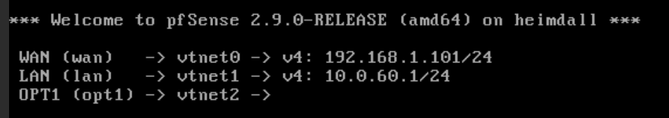

### Les VLAN

Je crée mon premier VLAN sur le port du trunk, puis les quatre autres.

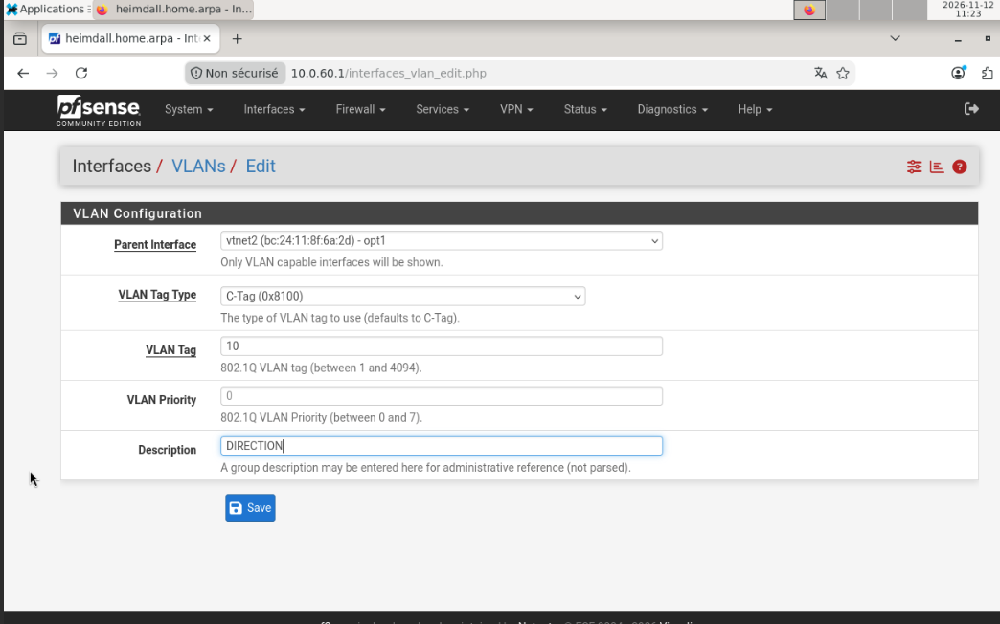

| VLAN | Zone | Réseau | Adresses |
|---|---|---|---|
| 10 | Direction | `10.0.10.0/24` | DHCP |
| 20 | DMZ | `10.0.20.0/24` | fixes |
| 30 | Employés | `10.0.30.0/24` | DHCP |
| 40 | Active Directory | `10.0.40.0/24` | fixes |
| 50 | BYOD | `10.0.50.0/24` | DHCP |

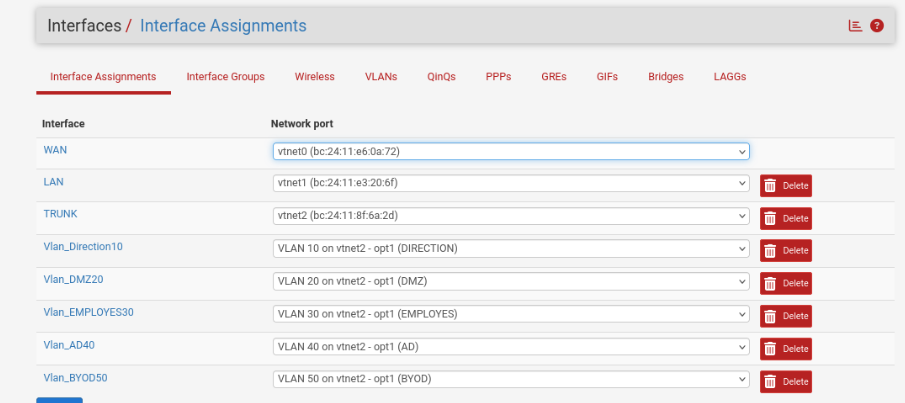

### Le DHCP

Je configure le DHCP pour le VLAN 10. À noter : j'utilise Kea, sur la recommandation de pfSense. Les VLAN 20 et 40 n'ont pas de DHCP, puisque leurs machines auront une adresse fixe.

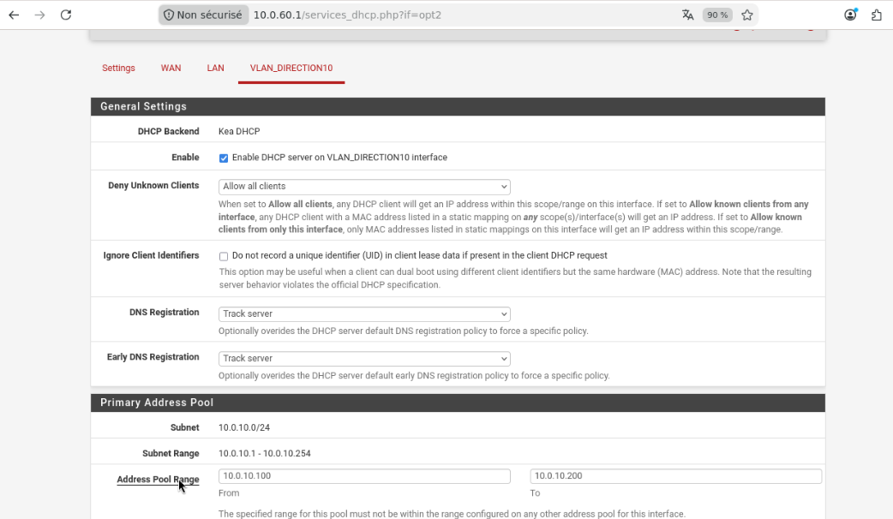

## Le pare-feu

pfSense bloque tout par défaut sur une nouvelle interface : il faut ouvrir ce qui est utile. Les règles s'appliquent au trafic qui **entre** par l'interface, et la première qui correspond gagne. Leur ordre compte donc autant que leur contenu.

Je commence par des alias, pour y voir clair :

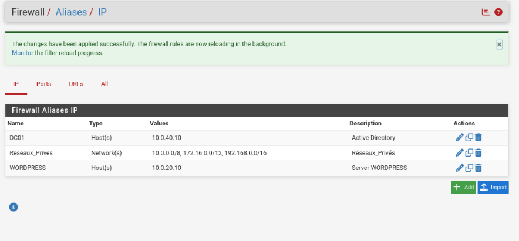

### BYOD

Les appareils personnels peuvent demander leur DNS à pfSense et aller sur Internet, mais n'atteignent aucune zone interne.

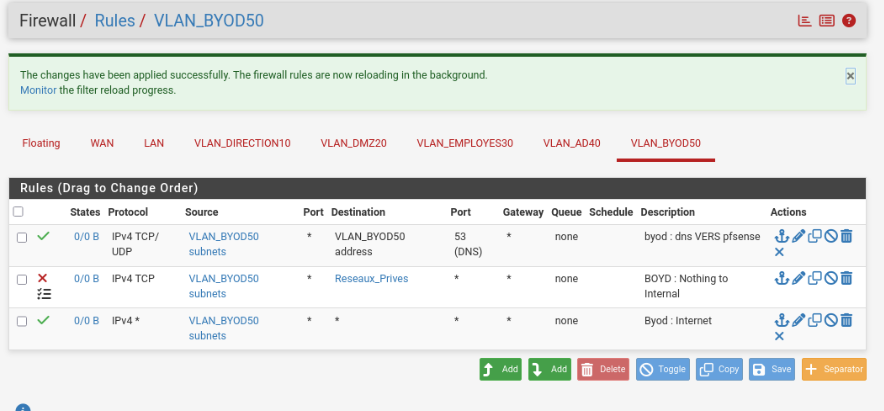

### DMZ

Pour la DMZ, le principe est de ne laisser sortir que le strict nécessaire, et de ne jamais rien initier vers l'intérieur. Comme je vais répéter les mêmes ports dans plusieurs règles, je les regroupe dans un alias :

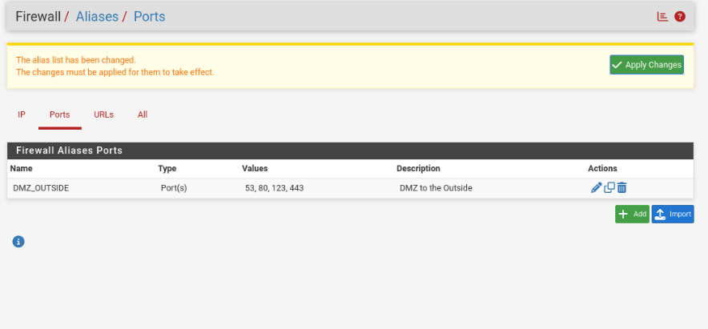

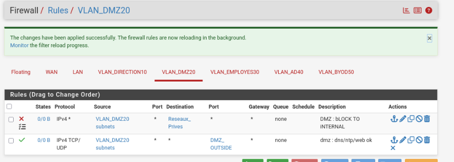

### Direction et Employés

Mêmes règles pour les deux zones : l'annuaire et le serveur WordPress sont joignables, le reste du réseau interne est bloqué, Internet est autorisé.

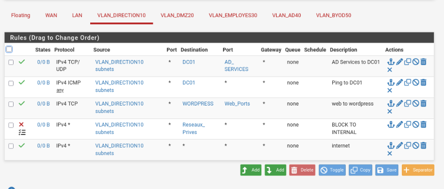

### Active Directory

La zone de l'annuaire peut sortir sur le strict nécessaire (DNS, heure, web pour les mises à jour), mais pas vers les autres zones.

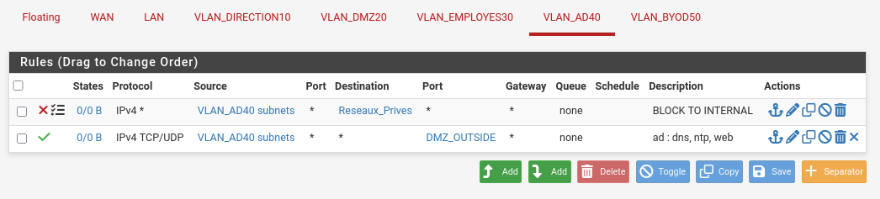

Voilà, le pire est passé. Je ne suis pas fan de la configuration de pfSense, je le confesse, mais cela doit être fait sérieusement et méticuleusement.

## Ce qui a coincé

- **Un conflit d'adresse dès l'installation.** pfSense s'était attribué l'adresse de ma box, et je ne pouvais plus joindre Netgate. Je l'ai résolu en relançant l'installation sans configurer le LAN.
- **L'ordre des règles.** Une règle « tout autoriser » placée au-dessus d'une règle de blocage la rend inutile. Il faut toujours mettre les blocages avant les autorisations larges.

## La prochaine étape

Le réseau est en place. Dans l'[article suivant](../phase-02-annuaire-postes-sauvegardes/), j'installe l'annuaire Active Directory, je place deux postes dans deux zones, je teste l'isolation entre elles, et je sauvegarde le tout.
