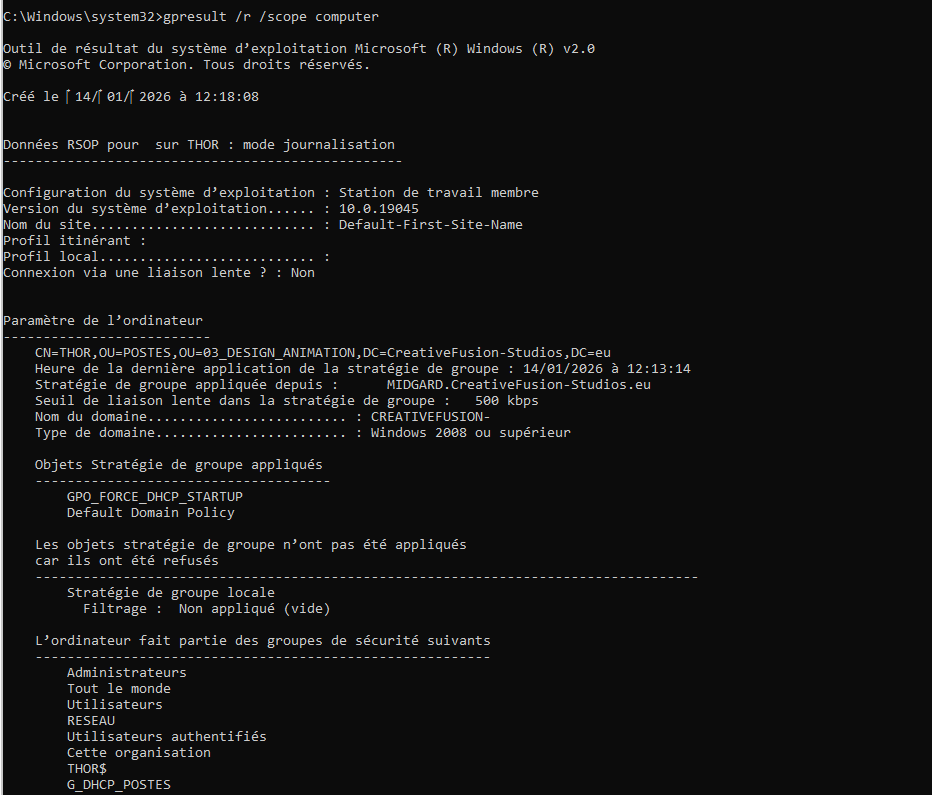

*Épreuve pratique (ECF) du Titre Professionnel Technicien Supérieur Systèmes et Réseaux (TSSR, RNCP niveau 5), 2026.*

**Une entreprise fictive, sept missions, et une preuve horodatée pour chaque étape.**

## Le sujet

L'épreuve met en scène un studio de design fictif, *CreativeFusion Studios*. Ses problèmes sont très courants : un mot de passe par application, des demandes de support perdues entre mails et appels, et tous les services sur un même réseau à plat. Ma mission était d'y remédier, puis de prouver chaque étape par des captures horodatées.

## Ce que j'ai mis en place

**Un domaine Windows.** Windows Server 2022, Active Directory et DNS, avec une arborescence d'OU calquée sur l'organigramme, qui sépare utilisateurs et ordinateurs dans chaque service. Puis une étendue DHCP par service.

**Un serveur de ticketing.** GLPI 11 sur Debian 13 sans interface graphique : Apache, PHP-FPM, MariaDB. J'ai sorti la configuration, les données et les journaux de la racine web, et durci les cookies de session PHP.

**Une connexion unique pour le support.** GLPI authentifie les utilisateurs sur l'Active Directory via un compte de service dédié. Les salariés se connectent avec leur mot de passe de domaine habituel.

**La segmentation du réseau.** Dans Cisco Packet Tracer : six VLAN sur un switch 2960 et un routeur 2901 en « router-on-a-stick », avec relais DHCP vers le serveur. Chaque service reçoit son adresse automatiquement et peut toujours joindre les autres.

**La sauvegarde des configurations.** Les configurations du switch et du routeur copiées sur un serveur FTP.

**Une GPO contre les IP fixes.** Un script de démarrage, stocké dans SYSVOL et filtré sur un groupe de sécurité, remet chaque carte réseau en DHCP.

## Le nommage

La RFC 1178 recommande de nommer les machines d'après un thème plutôt que leur rôle. Le contrôleur de domaine s'appelle **MIDGARD**, le serveur GLPI **YGGDRASIL**, le poste de test **THOR**. Pour quelqu'un qui met le cap au nord, ça s'imposait.

## Ce que j'en retiens

J'ai volontairement gardé certaines de mes erreurs dans la documentation. Un mauvais masque de sous-réseau, refusé par l'IOS. Une sauvegarde du switch en échec, parce qu'un switch de niveau 2 n'a pas d'adresse IP tant qu'on ne lui en donne pas. Et une faute de frappe dans le script de la GPO, repérée des mois plus tard en préparant cette page. La GPO s'appliquait, mais une ligne du script aurait échoué. Leçon retenue : un script se teste à la main sur un poste avant qu'une GPO ne le pousse sur tous les autres.

Avec un regard sécurité, je changerais aussi plusieurs choses sur un vrai réseau : LDAPS au lieu de LDAP en clair, HTTPS pour GLPI, SFTP plutôt que FTP, et les comptes GLPI par défaut modifiés dès l'installation. La liste complète est dans le dépôt.

## Technologies

Windows Server 2022 · Active Directory · DNS · DHCP · GPO · PowerShell · Debian 13 · Apache · PHP-FPM · MariaDB · GLPI 11 · LDAP · Cisco IOS · Packet Tracer

Sur GitHub, chaque mission a sa page (en anglais) : le besoin, les commandes et fichiers de configuration (retranscrits depuis mes captures), et la preuve que ça fonctionne.


Documentation sur GitHub


